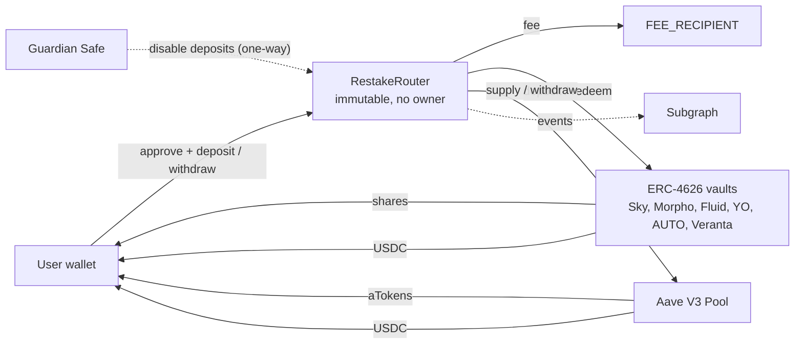
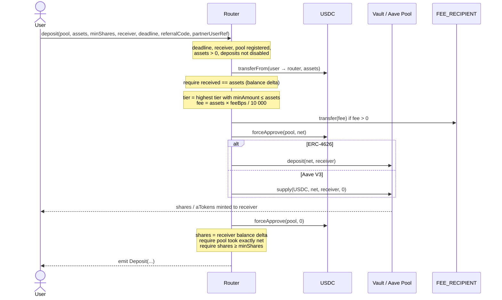
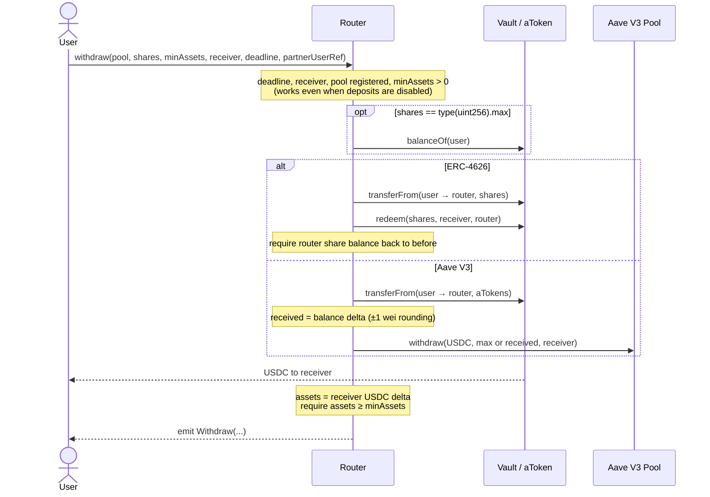
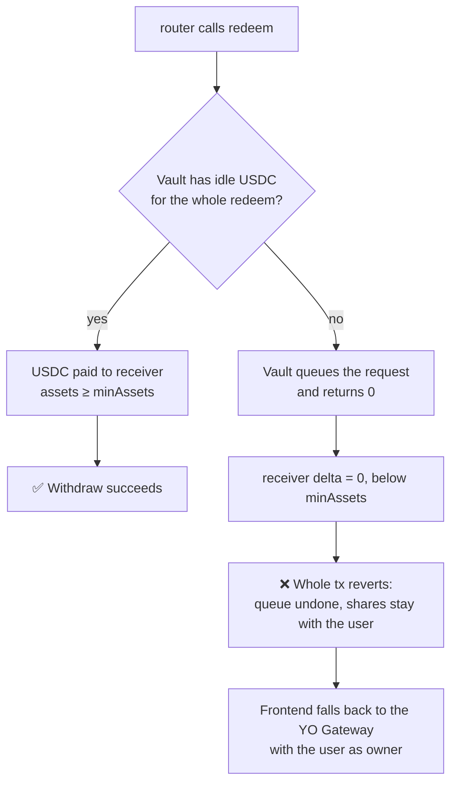
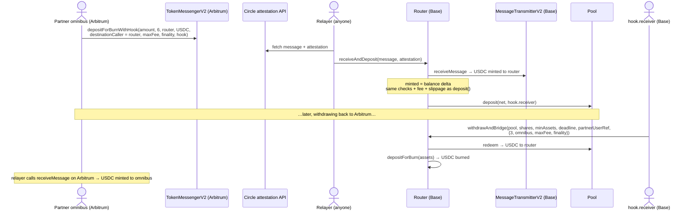
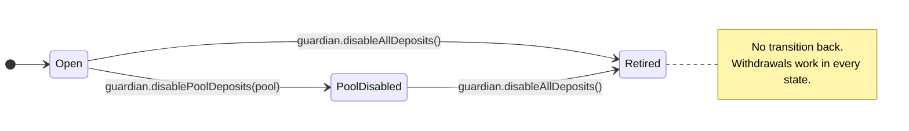
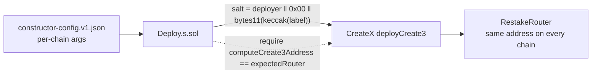

# Restake DeFi Router

A single immutable contract on Base that deposits USDC into a fixed set of yield venues and withdraws from them. It takes a tiered fee on deposits and nothing on withdrawals. It has no owner and no upgrade path, and it never holds user funds between transactions.

| Protocol | Venue | Integration |
|---|---|---|
| Sky | Spark USDC Vault `sUSDC` | ERC-4626 |
| Morpho | 8 USDC vaults (6 Vault V2, 2 Vault V1) | ERC-4626 |
| Fluid | `fUSDC` | ERC-4626 |
| Aave V3 | `aBasUSDC` | `IPool.supply` / `withdraw` |
| YO Protocol | `yoUSD` | ERC-4626 (async redeem fallback) |
| AUTO Finance | `baseUSD` Autopool | ERC-4626 |
| Veranta | `avUSDC` | ERC-4626 |

The full design rationale is in [docs/architecture-v1.0.md](docs/architecture-v1.0.md).

---

## Key features

- **Immutable and ownerless.** No proxy, no `delegatecall`, no admin and no setters. The fee recipient, guardian, USDC and Aave Pool addresses are `immutable`. The pool list and fee tiers are validated and written once, in the constructor. Changing any of them means deploying a new router release.
- **Non-custodial.** Vault shares and aTokens go straight to the user's wallet. The router's balance of every token is zero at the end of every call, and so is every allowance it has granted. Because users hold their own positions, moving to a new router release requires no fund migration.
- **Tiered deposit fee, no withdrawal fee.** The fee depends on the size of a single deposit, is capped at 1% (`MAX_FEE_BPS = 100`), rounds down in the user's favor, and always goes to `FEE_RECIPIENT`.
- **Two integration shapes, handled inline.** A `PoolType` enum (`ERC4626`, `AAVE_V3`) selects the code path. There are no external adapters.
- **Balance-delta accounting.** Shares, assets and pulled amounts are measured as balance changes, never taken from return values. This rejects fee-on-transfer tokens, catches vaults that misreport, and handles Aave's 1-wei rounding.
- **One-transaction deposits with USDC permit.** `depositWithPermit` takes an EIP-2612 signature for exactly the deposit amount instead of a prior `approve`. This suits EOA and MPC omnibus wallets. The permit owner is always `msg.sender`, and a front-run permit doesn't break the deposit.
- **User protection on every call:** `minShares` / `minAssets` slippage bounds, a `deadline`, `ReentrancyGuardTransient`, and exact-amount approvals that are reset to 0 after each call.
- **Async redeems never get stuck.** `minAssets` must be greater than 0. If a vault queues a redeem instead of paying out (YO without idle liquidity), the whole transaction reverts and the shares stay with the user.
- **"Withdraw all".** Passing `shares = type(uint256).max` withdraws the caller's full balance as read inside the transaction. This matters for rebasing aTokens, where an amount signed in the UI would leave dust.
- **One-way guardian kill switches.** The guardian can disable deposits for one pool or for all pools. Nobody can re-enable them, and withdrawals can never be blocked.
- **Permissionless and referral-aware.** Anyone can deposit or withdraw. A `bytes32 referralCode` is emitted with every deposit for off-chain attribution, and a `bytes32 partnerUserRef` with every deposit and withdrawal so omnibus partners can map them to their own users. Neither changes the fee.
- **Cross-chain USDC through Circle CCTP V2.** A partner on another chain (e.g. an Arbitrum omnibus) can burn USDC with a deposit hook, and the router mints it on Base and deposits it in the same call (`receiveAndDeposit`). `withdrawAndBridge` redeems on Base and burns the USDC straight to an address on another chain. Same fee schedule, no fee on refunds or withdrawals, and the router still holds nothing between calls.
- **Same address on every chain.** The router is deployed through CreateX CREATE3 with a permissioned salt, so its address depends only on the deployer and the release label, not on per-chain constructor arguments.
- **Indexer-ready events.** `Deposit` carries the gross amount, fee, net amount, shares, tier, referral code and partner user reference; `Withdraw` carries the partner user reference too. The constructor emits the full config (`FeeTiersSet`, `PoolAdded`), so a subgraph can index everything without extra RPC calls.

---

## How it works

### Components



Pools are keyed by the token the user ends up holding: the vault address for ERC-4626, and the aToken for Aave.

### Deposit



### Withdraw

The router pulls the shares and redeems them as owner, rather than relying on each vault's allowance logic. This behaves the same for every vault.



When the router held no aTokens before the call, it withdraws `type(uint256).max`. This burns its whole position, so no scaled-balance dust is left behind. If someone has donated aTokens to the router, it withdraws only the received amount, and `sweep` can recover the donation.

### Async redeems (YO)



### Cross-chain via CCTP (e.g. Arbitrum omnibus ⇄ Base)



`hookData` is `abi.encode(pool, minShares, receiver, deadline, referralCode, partnerUserRef)`. `destinationCaller` **must** be the router: otherwise anyone can relay the burn without depositing, and the USDC is stranded in the router, where `sweep` sends it to the fee recipient. If a CCTP deposit can't go through, `receiveAndRefund` pays the USDC out on Base to `hook.receiver`, with no fee. The receiver can call it at any time; anyone can call it after the deadline. Full design: [architecture §4.8](docs/architecture-v1.0.md).

### Fee tiers

The tier is chosen from the gross amount of a single deposit, not a per-user running total. Splitting a deposit into smaller pieces only moves it into a more expensive tier.

| Tier | Deposit (USDC) | `minAmount` (raw, 6 decimals) | Fee |
|---|---|---|---|
| 0 — Standard | 0 – 9,999.99 | `0` | 0.30% |
| 1 — Plus | 10,000 – 99,999.99 | `10_000e6` | 0.20% |
| 2 — Whale | ≥ 100,000 | `100_000e6` | 0.10% |

```
fee = gross × feeBps / 10_000   (rounds down)
net = gross − fee
```

The constructor rejects a schedule unless it has 1–5 tiers, `tiers[0].minAmount == 0`, strictly ascending `minAmount`, and every `feeBps ≤ 100`.

### Kill switches



The worst a compromised guardian can do is stop deposits. That costs a redeploy, never funds.

### Deployment (CREATE3)



| Salt bytes | Value | Why |
|---|---|---|
| 0–19 | Deployer address | Only our deployer can claim this address, on any chain |
| 20 | `0x00` | No chainId mixed in, so the address is the same on every chain |
| 21–31 | `bytes11(keccak256("restake.router.v1.0"))` | One address per release |

---

## Security invariants

These are checked by the invariant suite in [test/invariant/](test/invariant/):

1. The router only pulls funds from `msg.sender`, so standing approvals to it are safe.
2. The router's balance of every token is zero after every user call.
3. Every fee goes to `FEE_RECIPIENT` and is at most `gross × MAX_FEE_BPS / 10_000`.
4. No role can block withdrawals.
5. Every allowance the router has granted to a vault, the Aave Pool or the CCTP TokenMessenger is 0 after each call.
6. The pool list and fee tiers never change after construction.

---

## Integration notes for the frontend

| Pool | Note |
|---|---|
| Morpho Vault V2 | `maxDeposit` and the other `max*` functions always return 0 by design. Don't use them to size or gate deposits. |
| AUTO baseUSD | The Autopool's `previewRedeem` changes state internally, so it reverts through the router's read-only `previewWithdraw`. Quote it by `eth_call`ing the vault's `previewRedeem` directly, and size `minAssets` with a tolerance. |
| Veranta avUSDC | Charges about a 1.48% exit fee (`previewRedeem` < `convertToAssets`). Show it to the user. |
| YO yoUSD | If a withdrawal reverts with `SlippageExceeded(0, …)`, the vault lacks idle liquidity. Fall back to the YO Gateway. |
| `depositWithPermit` | Sign the EIP-2612 permit with `spender = router`, `value = assets`, and the same `deadline` as the deposit. ECDSA only: smart-contract wallets should batch `approve` + `deposit`. |
| CCTP deposits | Set `destinationCaller = mintRecipient = router`. Size `minShares` from `amount − maxFee − router fee`, and give `deadline` enough slack for attestation: seconds for fast transfers, ~15–20 min for standard ones. |
| CCTP withdrawals | The share owner on Base calls `withdrawAndBridge`. The destination needs a relayer (or the recipient) to call `receiveMessage` there; `destinationCaller` is 0. |
| Aave aBasUSDC | For a full exit, pass `shares = max` and approve a buffer (or `max`), because the balance grows every block. |

---

## Repository layout

| Path | Contents |
|---|---|
| [src/RestakeRouter.sol](src/RestakeRouter.sol) | The router |
| [src/libraries/FeeLib.sol](src/libraries/FeeLib.sol) | Tier validation, lookup and fee math (pure) |
| [src/interfaces/](src/interfaces/) | `IRestakeRouter`, `IAaveV3Pool`, `IAToken`, `ICreateX`, `ICctpV2` (Circle TokenMessengerV2 / MessageTransmitterV2) |
| [script/Deploy.s.sol](script/Deploy.s.sol) | CreateX deployment driven by [script/config/constructor-config.v1.json](script/config/constructor-config.v1.json) |
| [test/unit/](test/unit/) | Mock-based unit and fuzz tests |
| [test/invariant/](test/invariant/) | Invariant suite (random action sequences) |
| [test/fork/](test/fork/) | Base mainnet fork: real CreateX deployment and a round trip through all 14 pools |
| [subgraph/](subgraph/) | The Graph schema and mappings |

---

## Develop

Requires [Foundry](https://getfoundry.sh). The project pins solc `0.8.28` with `evm_version = cancun`.

```sh
forge build
forge test                                                   # unit + fuzz + invariant (fork tests skip without an RPC)
BASE_RPC_URL=<rpc> forge test --match-path 'test/fork/*'     # BASE_FORK_BLOCK=0 for latest
```

Subgraph:

```sh
cd subgraph && npm ci && npm run abi && npx graph codegen && npx graph build
```

## Deploy

1. In the chain's entry of [constructor-config.v1.json](script/config/constructor-config.v1.json), fill in `deployer`, `feeRecipient`, `guardian` and `expectedRouter`. Set `verified: true` on each pool once it has passed the onboarding checklist (architecture §8).
2. Run the fork tests against that config.
3. Deploy with the deployer's key:

   ```sh
   forge script script/Deploy.s.sol --rpc-url base --account <deployer-keystore> --broadcast --verify
   ```

   The script refuses to deploy if any placeholder is still zero, if any pool is unverified, or if the CreateX-predicted address doesn't match `expectedRouter`. Broadcasting fails unless the wallet is the configured `deployer`.
4. Set the router address and deploy block in [subgraph/subgraph.yaml](subgraph/subgraph.yaml).

### Test deployment

[constructor-config.v1-test.json](script/config/constructor-config.v1-test.json) has the same constructor arguments as v1 but its own salt label (`restake.router.v1.0-test`), so a rehearsal deploy gets a different address and never claims the production one. Fill in its placeholders the same way, then:

```sh
CONFIG_PATH=script/config/constructor-config.v1-test.json \
  forge script script/Deploy.s.sol --rpc-url base --account <deployer-keystore> --broadcast --verify
```

`test/unit/DeployScript.t.sol` checks that both files have the same protocol config (USDC, Aave, CCTP, fee tiers, pools) under different salts. The operator addresses (`deployer`, `feeRecipient`, `guardian`) may differ. Keep the protocol config in sync when you edit v1.

## License

[Business Source License 1.1](LICENSE). Converts to GPL-2.0-or-later on 2030-10-27.
