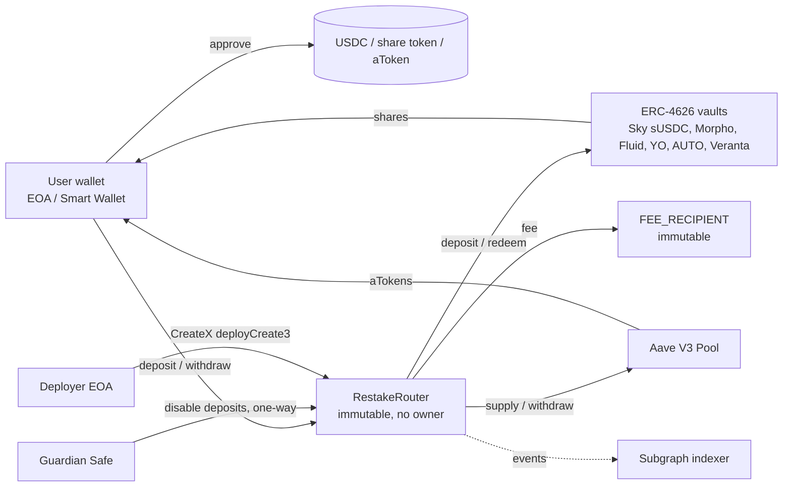
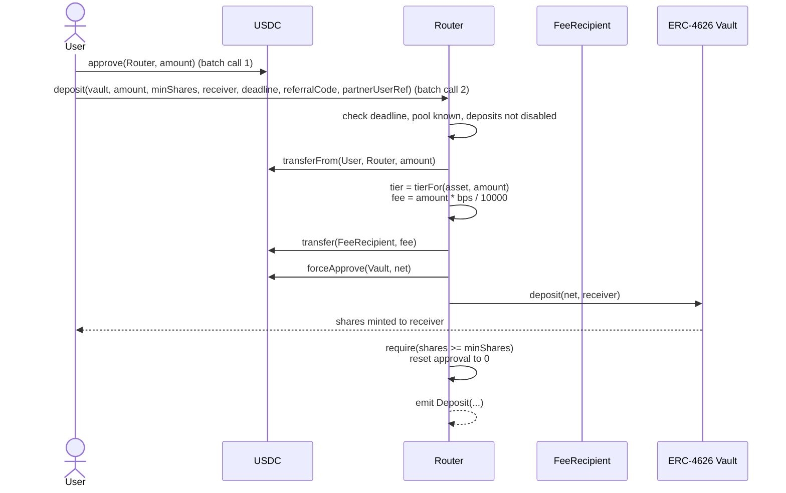
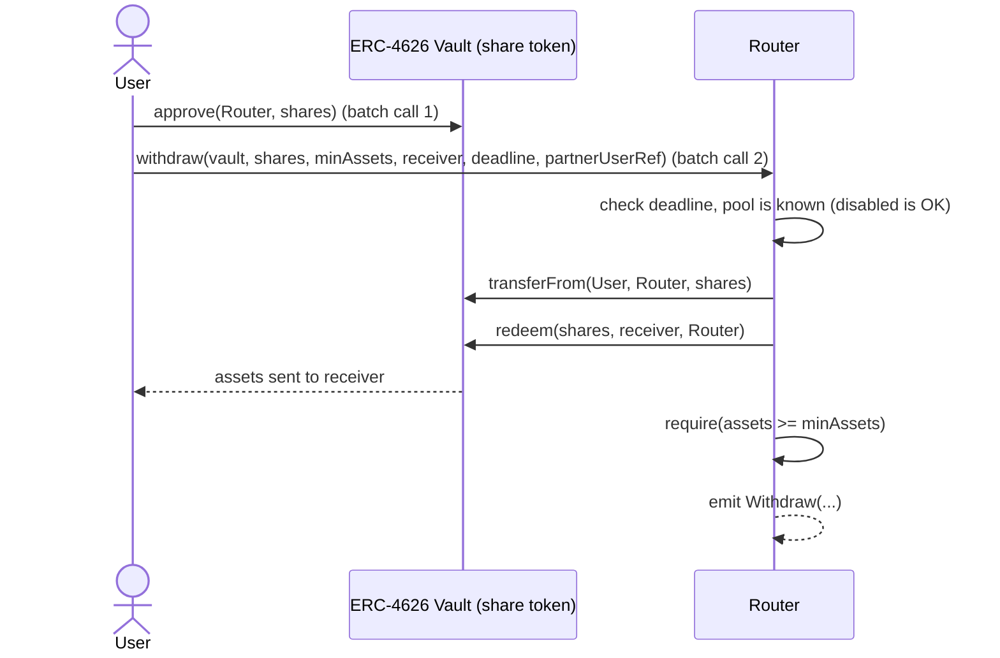

# Restake DeFi Router — Architecture & Functional Design (v1.0)

| | |
|---|---|
| Status | Draft for review |
| Version | v1.0 |
| Chain | Base (chainId `8453`). Same address on any future chain via CREATE3 (§10). |
| Date | 2026-10-27 |

---

## 1. Goals and non-goals

### Goals

1. A single **immutable** (non-upgradeable) router contract on Base through which end users can **deposit into** and **withdraw from** a fixed set of yield venues:

   | Protocol | Integration | Pool type |
   |---|---|---|
   | Sky (sky.money) | Spark USDC Vault `sUSDC` (ERC-4626 over sUSDS) | `ERC4626` |
   | Morpho | Vault (ERC-4626) | `ERC4626` |
   | Fluid | fToken (ERC-4626) | `ERC4626` |
   | Aave V3 | `IPool.supply / withdraw` (aTokens) | `AAVE_V3` |
   | YO Protocol | yoVault (ERC-4626, async redeem fallback) | `ERC4626` |
   | AUTO Finance | Autopool (ERC-4626) | `ERC4626` |
   | Veranta (formerly Avantis) | USDC Vault `avUSDC` (ERC-4626) | `ERC4626` |

2. A **deposit fee**, sized by a **tiered fee schedule** that depends on the deposit amount, paid to a **fee recipient address that is fixed at deploy time**.
3. **No fee on withdrawals.**
4. **No admin over config.** The pool list and fee tiers are passed to the constructor, validated there, and can never change. A new pool or new fees means a new router deployment.
5. **Deterministic, chain-independent address**: deployed through CreateX `deployCreate3`, so every chain can get the same router address even though each chain has its own config.
6. **Events** for every deposit and withdrawal, with enough data for a subgraph (The Graph) to index without extra RPC calls.
7. **Non-custodial**: the router never holds user funds between transactions. Vault shares and aTokens go straight to the user's wallet.
8. **Permissionless**: any address can deposit and withdraw. The router has no user allowlist, KYC gate or per-user limits.
9. **USDC only**: every pool's underlying is native USDC. The router has one `USDC` address and one fee schedule.

### Non-goals (v1.0)

- Deploying on chains other than Base (the deployment method supports it; the v1.0 rollout doesn't do it).
- Assets other than USDC (USDS, WETH, cbBTC, EURC, …). Adding one means a new release with per-asset fee tiers.
- Swaps or zaps (e.g. depositing ETH into a USDC vault).
- Router-managed async withdrawals (ERC-7540 request/claim flows). See YO in §8.
- Oracle-priced (USD) fee tiers.
- Withdrawal fees, performance fees, on-chain referral payouts (the referral code is tracking only, §4.7). Our own referral code in Spark's program is deferred to a later release.
- End-user access control (allowlists, KYC gating). Anyone can use the router. Any screening the product needs happens in the frontend, not on-chain.
- Upgradeability or any on-chain config changes. Any change ships as a new router deployment (§10).

---

## 2. What "immutable" means here

| Aspect | v1.0 decision |
|---|---|
| Contract code | **Immutable.** No proxy, no `delegatecall`, no `selfdestruct`. |
| Owner / admin | **None.** No `Ownable`, no setters for config. |
| Fee recipient | **Immutable.** `address public immutable FEE_RECIPIENT`. |
| Max fee cap | **Immutable.** `uint16 public constant MAX_FEE_BPS = 100` (1%). The constructor rejects any tier above it. |
| USDC | **Immutable**, set in the constructor. The only asset the router accepts. |
| Aave V3 Pool | **Immutable**, set in the constructor (`address(0)` if the chain has no Aave V3 pools). |
| Pool list | **Fixed at deploy.** Written to storage in the constructor; no function writes it again. |
| Fee tiers | **Fixed at deploy.** Same as the pool list. |
| Guardian | **Immutable** address (a Safe, which can rotate its own signers). |
| Deposit kill switches | Guardian can **disable** deposits, per pool or globally. **One-way**: nobody can re-enable them. Withdrawals can't be disabled. |

Solidity `immutable` can't hold mappings or arrays, so the pool list and fee tiers live in storage. Since no code path writes them after the constructor, they are immutable in effect.

Because the router is non-custodial (users hold their own shares and aTokens), a new router version needs **no fund migration**. Users keep their positions, and the frontend points to the new router.

---

## 3. High-level architecture



### Components

| Component | Responsibility |
|---|---|
| `RestakeRouter` | Single contract. Holds the deploy-time config, enforces the pool list, charges fees, routes deposits and withdrawals, emits events. |
| Pool types | Handled **inline** in the router through a `PoolType` enum (`ERC4626`, `AAVE_V3`). No external adapters and no `delegatecall`. A new type needs a new router version. |
| Guardian | Safe multisig / monitoring bot. Can only **disable deposits** (per pool or globally), irreversibly. It can't re-enable, change fees, or touch withdrawals. |
| Deployer | Dedicated EOA that owns the CreateX permissioned salt (§10). It has no power over a deployed router, but it's the only key that can claim the router address on a new chain. |
| Subgraph | Indexes the `Deposit`, `Withdraw` and config events (config events are emitted from the constructor). |

### Why one router with inline pool types (and not adapters)

- v1.0 has only two integration shapes: ERC-4626 and Aave V3. Sky is reached through Spark's ERC-4626 `sUSDC` vault, so it needs no special path.
- External adapter contracts would add a mutable trust surface (an adapter registry) to a contract meant to be immutable.
- Fewer contracts make the audit cheaper.

---

## 4. User flows

### 4.1 Deposit (ERC-4626 vault)



### 4.2 Deposit (Aave V3)

Same as above, except the router calls `AAVE_POOL.supply(asset, net, receiver, 0)`. The aTokens are minted straight to `receiver`, and `shares` is the receiver's aToken balance delta.

### 4.3 Withdraw (ERC-4626 vault)



Design choice: the router **pulls the shares and redeems as owner**, rather than calling `redeem(shares, receiver, owner=user)` and relying on the vault's allowance logic. This behaves the same for every vault, makes the balance-delta checks simple, and avoids edge cases in how vaults implement allowances.

`minAssets` must be > 0. If a vault queues the redeem instead of paying out (YO without idle liquidity, §8), the receiver's balance delta is below `minAssets` and the whole transaction reverts, so shares are never stuck in a queue owned by the router.

### 4.4 Withdraw (Aave V3)

1. The user approves aTokens to the router.
2. `withdraw(aToken, amount, minAssets, receiver, deadline, partnerUserRef)` is called.
3. The router pulls the aTokens using a **balance-delta** measurement, because aToken transfers can be off by 1 wei due to scaled-balance rounding.
4. The router calls `AAVE_POOL.withdraw(asset, received, receiver)`.

### 4.5 "Withdraw all"

Passing `shares == type(uint256).max` means "withdraw my whole balance". The router reads `balanceOf(msg.sender)` inside the transaction. This matters most for **aTokens**, which rebase: their balance grows every block, so an exact amount signed in the UI would leave dust. The frontend should approve a small buffer (or `max`) for aToken full exits.

### 4.6 Transaction batching

| Wallet type | Flow |
|---|---|
| Smart wallets (Coinbase Smart Wallet, Safe, 7702-delegated EOAs) | `wallet_sendCalls` (EIP-5792) with `[approve, deposit]` in **one user confirmation**. |
| Plain EOAs and MPC wallets (e.g. partner omnibus wallets) | **Deposit:** one transaction with `depositWithPermit`, using an off-chain EIP-2612 USDC signature. **Withdraw:** two transactions, `approve` then `withdraw`. |

#### `depositWithPermit` (deposit only)

Native USDC implements EIP-2612, so a deposit needs no prior `approve` transaction. `depositWithPermit(pool, assets, minShares, receiver, deadline, referralCode, partnerUserRef, v, r, s)`:

1. Calls `USDC.permit(msg.sender, router, assets, deadline, v, r, s)`. The permit **owner is always `msg.sender`**, so invariant 1 still holds: a third party holding someone else's signature can't spend their USDC through the router.
2. Runs the same code path as `deposit`.

Design points:

- **Exact amount.** The signature authorizes exactly `assets`, which the deposit consumes in full, so no standing allowance is left behind.
- **Shared deadline.** `deadline` is both the permit deadline and the deposit deadline.
- **Front-run tolerant.** If someone submits the same signature to USDC first, the router's `permit` call reverts on the used nonce, but the allowance is already in place. The router ignores permit failures (`try`/`catch`), and the pull fails with `ERC20InsufficientAllowance` only if there really is no allowance. This also lets a caller that already approved pass a dummy signature.
- **Gas.** Measured on a Base fork against Aave: about 436k gas for one `depositWithPermit` transaction vs 461k for `approve` + `deposit`, saving the second transaction's 21k base cost and its L1 data fee.
- **ECDSA signatures only.** This is the standard `(v, r, s)` EIP-2612 permit, which suits EOAs and MPC wallets. Smart-contract wallets (Safe, ERC-1271) should batch `approve` + `deposit` instead (§4.6, row 1). USDC's non-standard `bytes signature` overload isn't used.
- **No permit on withdrawals.** Not every share token supports permit, so withdrawals keep the same `approve` + `withdraw` flow for every pool.

### 4.7 Referral codes and partner user references

`deposit` takes a `bytes32 referralCode`, which the router emits unchanged in the `Deposit` event.

- **Tracking only.** The code doesn't change the fee tier, the fee amount, or where the fee goes. Every fee still goes to `FEE_RECIPIENT`. Revenue sharing with referrers is settled off-chain from subgraph data.
- **Unvalidated.** Any value is accepted; `bytes32(0)` means "no referral". There's no on-chain registry, which keeps the router free of admin state. The subgraph and backend map codes to partners and ignore unknown codes.
- **Encoding.** The frontend and partners agree on one format, e.g. a short ASCII tag right-padded to 32 bytes, or `keccak256(partnerId)`.
- **Not on withdrawals.** Withdrawals carry no fee, so there's nothing to attribute.

Deposits and withdrawals (including `depositWithPermit`, the CCTP hook and `withdrawAndBridge`) also take a `bytes32 partnerUserRef`, emitted unchanged in `Deposit` and `Withdraw`.

- **Why.** An omnibus partner deposits and withdraws from one wallet on behalf of many end users, so `sender` and `receiver` can't tell those users apart. The partner sets `partnerUserRef` to identify the end user and matches its own deposits and withdrawals to that user from the events.
- **Separate from `referralCode`.** The referral code says *which partner* brought the deposit; `partnerUserRef` says *which of the partner's users* it belongs to. Keeping both lets a partner be attributed and reconcile per user at the same time.
- **Tracking only, unvalidated.** Same rules as the referral code: any value, `bytes32(0)` = none, no effect on fees, shares or where funds go. The router doesn't link a withdrawal's reference to the deposit's; that matching is the partner's.
- **Encoding.** Chosen by the partner. A salted hash (e.g. `keccak256(salt, userId)`) keeps internal user IDs off-chain, since every event is public.

### 4.8 Cross-chain deposits and withdrawals (CCTP V2)

Partners that hold USDC on another chain (for example an omnibus wallet on Arbitrum) can deposit into a Base pool and get their USDC back on the other chain without a manual bridge step. The router integrates Circle **CCTP V2** directly: native USDC is burned on one chain and minted on the other, with no wrapped asset and no liquidity pool in between.

The CCTP addresses are `immutable`: `CCTP_TOKEN_MESSENGER` comes from the constructor, while `CCTP_MESSAGE_TRANSMITTER` and `CCTP_LOCAL_DOMAIN` are read from it during construction. Passing `address(0)` deploys the router without CCTP; all three entry points then revert with `CctpNotSupported()`.

| | Base mainnet | Arbitrum One |
|---|---|---|
| `TokenMessengerV2` | `0x28b5a0e9C621a5BadaA536219b3a228C8168cf5d` | same |
| `MessageTransmitterV2` | `0x81D40F21F12A8F0E3252Bccb954D722d4c464B64` | same |
| CCTP domain | `6` | `3` |

#### Inbound: other chain → Base deposit

1. **Source chain.** The partner calls `TokenMessengerV2.depositForBurnWithHook` with:
   - `destinationDomain = 6` (Base)
   - `mintRecipient = bytes32(router)`
   - `destinationCaller = bytes32(router)`
   - `hookData = abi.encode(CctpDepositHook{pool, minShares, receiver, deadline, referralCode, partnerUserRef})`, exactly 192 bytes
   - `maxFee` / `minFinalityThreshold`: 1000 for fast or 2000 for standard finality
2. **Attestation.** A relayer (our backend, or anyone) fetches the attestation from Circle's Iris API.
3. **Base.** The relayer calls `router.receiveAndDeposit(message, attestation)`. The router:
   - checks that the message's `recipient` is the local TokenMessenger and its `mintRecipient` is the router;
   - calls `MessageTransmitterV2.receiveMessage`;
   - measures the USDC it actually received as a **balance delta**, net of any fast-transfer fee;
   - decodes the hook and runs the same checks and code path as `deposit`: deadline, receiver, pool registered, kill switches, tiered fee on the minted amount, `minShares`;
   - emits `CctpReceived` and then `Deposit`. The `Deposit` event's `sender` is the relayer; the source-chain burner is `CctpReceived.messageSender`.

Any failure reverts the whole call, including `receiveMessage`. The CCTP nonce stays unused, so the message can be relayed again. If the deposit can never succeed (the pool's deposits are disabled, the deadline has passed, or the hook is invalid), `receiveAndRefund(message, attestation)` mints the USDC and sends it on Base, **with no fee**:

| Hook | Who can call | USDC goes to |
|---|---|---|
| Valid | `hook.receiver` at any time; anyone after `hook.deadline` | `hook.receiver` |
| Malformed (wrong length, dirty address words, receiver zero / router / pool) | Anyone | `messageSender` read as an address on Base (EVM sources only; reverts otherwise) |

Refunds pay out on Base rather than bouncing back over CCTP, because a burn can require a nonzero `minFee` even at standard finality, and the refund has nothing to pay it from.

**`destinationCaller` must be the router.** If it is `bytes32(0)`, anyone can relay the message directly to the MessageTransmitter. The USDC is then minted to the router with no deposit, and `sweep` sends it to `FEE_RECIPIENT`. The router can't enforce this, because it is set on the source chain.

`hook.deadline` must cover the attestation delay: seconds for fast transfers, and roughly 15–20 minutes for standard transfers from L2s that wait for Ethereum finality. `minShares` should be sized from the expected minted amount (`amount − maxFee`) minus the router fee.

#### Outbound: Base withdrawal → other chain

`withdrawAndBridge(pool, shares, minAssets, deadline, partnerUserRef, CctpBridge{destinationDomain, mintRecipient, maxFee, minFinalityThreshold})`:

1. Runs the same redeem path as `withdraw`, with the router as the USDC receiver. It supports `shares = max`, requires `minAssets > 0`, and checks the USDC delta.
2. Approves `TokenMessengerV2` for exactly the redeemed amount, calls `depositForBurn` with `destinationCaller = 0`, then resets the approval to 0.
3. Emits `Withdraw(sender, receiver = router, …)` followed by `CctpBridged`.

The destination is rejected with `InvalidBridgeDestination()` when `mintRecipient` is zero, when it is the router's own address (the same on every chain under CREATE3, so the USDC would be swept there), or when `destinationDomain` is Base itself. Like `withdraw`, this path charges no router fee and can't be blocked by the guardian. The recipient gets `assets − feeExecuted`, where `feeExecuted ≤ maxFee`. With `destinationCaller = 0`, anyone can relay the message on the destination chain; our relayer, or the recipient itself, calls `MessageTransmitterV2.receiveMessage` there.

#### Trust assumptions

`TokenMessengerV2` and `MessageTransmitterV2` are upgradeable proxies owned by Circle, and the Circle attesters sign every message. That is the same trust already placed in Circle as the USDC issuer. The router treats Circle's contracts as trusted for minting, but never as trusted for amounts: what the router receives is always measured as a balance delta.

---

## 5. Deploy-time config

All config is passed to the constructor, validated there, and written once. There are no setters.

### 5.1 Pool list

Storage: `mapping(address pool => PoolType)` plus an `address[]` for enumeration. Every pool's underlying is `USDC`, so nothing else needs storing per pool.

```solidity
enum PoolType { NONE, ERC4626, AAVE_V3 }

mapping(address pool => PoolType) public poolType;      // NONE = not in this router
mapping(address pool => bool) public depositsDisabled;  // guardian kill switch, one-way
```

- **Key:** the token the user ends up holding.
  - ERC-4626: the vault address (also the share token).
  - Aave: the **aToken** address. It's unique per reserve.
- **Constructor checks, per pool:**
  - ERC-4626: `IERC4626(pool).asset() == USDC`.
  - Aave V3: `IAToken(pool).UNDERLYING_ASSET_ADDRESS() == USDC`, and `AAVE_POOL.getReserveData(USDC).aTokenAddress == pool`. Requires `AAVE_POOL != address(0)`.
  - No duplicate pools.
- Pools can never be removed. The guardian can only disable deposits. Withdrawals keep working for every pool, and users can always exit directly at the protocol, because the router is non-custodial.

**Base pool list (every address must be checked against official protocol docs and on-chain before deployment):**

| # | Protocol | Pool (key) | Type | Asset | Notes |
|---|---|---|---|---|---|
| 1 | Sky | sUSDC `0x3128a0f7f0ea68e7b7c9b00afa7e41045828e858` | ERC4626 | USDC | On-chain name **"Spark USDC Vault"** (symbol `sUSDC`): an ERC-4626 wrapper that routes USDC into sUSDS via PSM3, so the router treats it as a plain vault. `asset() == USDC`; shares have **18 decimals** (USDC has 6). `maxDeposit` is capped (~653K USDC of room at time of check). Withdrawals depend on PSM3 USDC liquidity. |
| 2 | Morpho | 8 USDC vaults (6 Vault V2, 2 Vault V1): Steakhouse Prime `0xbeef0e0834849acc03f0089f01f4f1eeb06873c9`, Gauntlet Prime (V2) `0x050ce30b927da55177a4914ec73480238bad56f0`, Gauntlet Frontier `0x1deefabee758aabdc29a542b24ca3b75afd56765`, Steakhouse High Yield `0xbeeff7ae5e00aae3db302e4b0d8c883810a58100`, Grove x Steakhouse `0xbeef0786756810478b88982de00f3cd7fdb8e7c7`, Clearstar cbAssets `0x91c056b6d4311a743614fbc03ac32d4e6a2d3a3c`, Gauntlet USDC Prime (V1) `0xee8f4ec5672f09119b96ab6fb59c27e1b7e44b61`, Spark USDC Vault (V1) `0x7bfa7c4f149e7415b73bdedfe609237e29cbf34a` | ERC4626 | USDC | All shares have 18 decimals. For Vault V2, confirm that no deposit/receive gates are set (they would block the router or the receiver). The Morpho "Spark USDC Vault" is a different contract from Sky's sUSDC (#1). |
| 3 | Fluid | fUSDC `0xf42f5795d9ac7e9d757db633d693cd548cfd9169` | ERC4626 | USDC | 6 decimals. |
| 4 | Aave V3 | aBasUSDC `0x4e65fe4dba92790696d040ac24aa414708f5c0ab` | AAVE_V3 | USDC | Aave Pool `0xA238Dd80C259a72e81d7e4664a9801593F98d1c5` (verify). |
| 5 | YO Protocol | yoUSD `0x0000000f2eb9f69274678c76222b35eec7588a65` | ERC4626 | USDC | On-chain: name/symbol `yoUSD`, `asset() == USDC`, 6 decimals, `maxDeposit` uncapped. Redeem is async without idle liquidity (§8). YO Gateway `0xF1EeE0957267b1A474323Ff9CfF7719E964969FA` (per Base docs, verify). |
| 6 | AUTO Finance | baseUSD Autopool `0x9c6864105aec23388c89600046213a44c384c831` | ERC4626 | USDC | Formerly Tokemak: the on-chain name is still **"Tokemak baseUSD"** (symbol `baseUSD`). `asset() == USDC`; shares have **18 decimals** (USDC has 6). `maxDeposit` effectively uncapped. |
| 7 | Veranta | avUSDC `0x944766f715b51967e56afde5f0aa76ceacc9e7f9` | ERC4626 | USDC | Formerly Avantis: the on-chain name is still **"Avantis USDC Vault"** (symbol `avUSDC`). `asset() == USDC`, 6 decimals, `maxDeposit` is capped (finite). Confirm withdrawal behavior (`maxWithdraw` / `maxRedeem`, any lock or epoch). |

USDC on Base: `0x833589fCD6eDb6E08f4c7C32D4f71b54bdA02913` (native USDC, not bridged USDbC).

### 5.2 Fee tiers

One schedule for the whole router: `FeeTier[] feeTiers`, with thresholds in raw USDC units (6 decimals). Because there's only one asset, raw amounts equal USD amounts and no oracle is needed.

```solidity
struct FeeTier {
    uint256 minAmount; // inclusive lower bound, in USDC base units
    uint16  feeBps;    // fee in basis points (1 bps = 0.01%)
}
```

**Constructor validation:**
- `1 <= tiers.length <= MAX_TIERS` (`MAX_TIERS = 5` as a constant; v1.0 uses 3).
- `tiers[0].minAmount == 0`, so every amount maps to a tier.
- `minAmount` is strictly ascending.
- `feeBps <= MAX_FEE_BPS` for every tier.

**Tier selection:** the highest tier with `minAmount <= grossAmount`. The amount used is the **gross amount of a single deposit**. It is not cumulative per user, which keeps the logic stateless.

Users can't game this downward: splitting a deposit only puts the pieces in a more expensive tier.

**v1.0 schedule (USDC, 6 decimals), confirmed:**

| Tier | Deposit amount (USDC) | `minAmount` (raw) | Fee | `feeBps` |
|---|---|---|---|---|
| 0 — Standard | 0 – 9,999.99 | `0` | 0.30% | `30` |
| 1 — Plus | 10,000 – 99,999.99 | `10_000e6` | 0.20% | `20` |
| 2 — Whale | ≥ 100,000 | `100_000e6` | 0.10% | `10` |

**Fee math:**

```
fee = grossAmount * feeBps / 10_000   // rounds down, in the user's favor
net = grossAmount - fee
```

When `fee == 0` (dust amounts or a 0-bps tier), the router skips the fee transfer.

### 5.3 Deposit kill switches

| Flag | Set by | Cleared by | Effect |
|---|---|---|---|
| `allDepositsDisabled` (global) | guardian | **nobody** | All deposits revert. Retires the router. |
| `depositsDisabled[pool]` | guardian | **nobody** | Deposits to that pool revert. |
| — | — | — | **Withdrawals can never be disabled.** |

One-way switches match the "new config = new deployment" rule. The worst a compromised guardian can do is stop deposits, which costs a redeploy, never funds. The trade-off, accepted for v1.0: a false alarm also costs a redeploy, so the guardian should disable only on a confirmed incident.

---

## 6. Contract interface

```solidity
// SPDX-License-Identifier: BUSL-1.1
pragma solidity 0.8.28;

interface IRestakeRouter {
    // ───────────── Types ─────────────
    enum PoolType { NONE, ERC4626, AAVE_V3 }

    struct FeeTier {
        uint256 minAmount;
        uint16 feeBps;
    }

    struct PoolInit {
        address pool;
        PoolType poolType;
    }

    // ───────────── User actions ─────────────

    /// @notice Pull `assets` of the pool's underlying from msg.sender, take the tiered fee,
    ///         deposit the rest into `pool`, and send the shares / aTokens to `receiver`.
    /// @param referralCode Opaque partner / referrer tag, emitted in `Deposit`. `bytes32(0)` = no referral.
    ///                     Tracking only: it doesn't change the fee or where it goes.
    /// @param partnerUserRef Opaque per-user tag set by an omnibus partner, emitted in `Deposit` (§4.7).
    /// @return shares     Shares (or aTokens) received by `receiver`.
    /// @return fee        Fee sent to FEE_RECIPIENT.
    function deposit(
        address pool,
        uint256 assets,
        uint256 minShares,
        address receiver,
        uint256 deadline,
        bytes32 referralCode,
        bytes32 partnerUserRef
    ) external returns (uint256 shares, uint256 fee);

    /// @notice `deposit` without a prior `approve`: first applies msg.sender's EIP-2612 USDC permit for exactly
    ///         `assets`, valid until `deadline` (§4.6). A failed permit (e.g. front-run) is ignored.
    function depositWithPermit(
        address pool,
        uint256 assets,
        uint256 minShares,
        address receiver,
        uint256 deadline,
        bytes32 referralCode,
        bytes32 partnerUserRef,
        uint8 v,
        bytes32 r,
        bytes32 s
    ) external returns (uint256 shares, uint256 fee);

    /// @notice Pull `shares` (or aTokens) from msg.sender, redeem them, and send the underlying to `receiver`.
    /// @param shares Pass type(uint256).max to withdraw msg.sender's full balance.
    /// @param minAssets Must be > 0, so a queued (async) redeem reverts instead of completing silently.
    /// @param partnerUserRef Same as in `deposit`, emitted in `Withdraw` (§4.7).
    /// @return assets Underlying received by `receiver`.
    function withdraw(
        address pool,
        uint256 shares,
        uint256 minAssets,
        address receiver,
        uint256 deadline,
        bytes32 partnerUserRef
    ) external returns (uint256 assets);

    /// @notice Sends any token balance held by the router to FEE_RECIPIENT. Callable by anyone.
    function sweep(address token) external;

    // ───────────── Views ─────────────
    function FEE_RECIPIENT() external view returns (address);
    function GUARDIAN() external view returns (address);
    function AAVE_POOL() external view returns (address);
    function USDC() external view returns (address);
    function MAX_FEE_BPS() external view returns (uint16);

    function poolType(address pool) external view returns (PoolType);
    function getPools() external view returns (address[] memory);
    function getFeeTiers() external view returns (FeeTier[] memory);
    function depositsDisabled(address pool) external view returns (bool);
    function allDepositsDisabled() external view returns (bool);

    /// @notice Quote for the frontend: fee, tier, net amount, and expected shares.
    function previewDeposit(address pool, uint256 assets)
        external
        view
        returns (uint256 fee, uint8 tierIndex, uint256 netAssets, uint256 expectedShares);

    function previewWithdraw(address pool, uint256 shares) external view returns (uint256 expectedAssets);

    // ───────────── Guardian (one-way) ─────────────
    function disablePoolDeposits(address pool) external;
    function disableAllDeposits() external;
}
```

### Constructor

```solidity
constructor(
    address feeRecipient_,
    address guardian_,
    address usdc_,                   // native USDC on this chain
    address aavePool_,               // address(0) if no AAVE_V3 pools on this chain
    address cctpTokenMessenger_,     // Circle TokenMessengerV2, or address(0) for no CCTP (§4.8)
    FeeTier[] memory feeTiers_,
    PoolInit[] memory pools_
)
```

- `FEE_RECIPIENT`, `GUARDIAN`, `USDC`, `AAVE_POOL` and the three `CCTP_*` values are `immutable`.
- Reverts if `feeRecipient_`, `guardian_` or `usdc_` is zero, or if any fee tier or pool check from §5 fails.
- Emits `FeeTiersSet` once and `PoolAdded` for every pool, so the subgraph reads the full config from the deploy block.
- The constructor must not read `msg.sender`: under CREATE3 it is the CreateX proxy, not the deployer.

### `sweep`

The router should never hold a balance at the end of a transaction. `sweep` only recovers tokens sent to it by mistake. Since every user action is atomic, it can't touch funds in flight. It needs no admin, because the destination is always `FEE_RECIPIENT`.

---

## 7. Events (for the subgraph)

```solidity
event Deposit(
    address indexed sender,     // msg.sender (payer)
    address indexed receiver,   // owner of the minted shares
    address indexed pool,       // vault / aToken
    address asset,              // underlying
    uint256 grossAssets,        // amount pulled from the sender
    uint256 fee,                // amount sent to FEE_RECIPIENT
    uint256 netAssets,          // amount deposited into the pool
    uint256 shares,             // shares / aTokens received by the receiver
    uint8   tierIndex,          // applied fee tier
    uint16  feeBps,             // applied fee rate
    bytes32 referralCode,       // caller-supplied tag, bytes32(0) = none
    bytes32 partnerUserRef      // omnibus partner's per-user tag, bytes32(0) = none (§4.7)
);

event Withdraw(
    address indexed sender,     // msg.sender (share owner)
    address indexed receiver,   // recipient of the underlying
    address indexed pool,
    address asset,
    uint256 shares,             // shares / aTokens spent
    uint256 assets,             // underlying sent to the receiver
    bytes32 partnerUserRef      // omnibus partner's per-user tag, bytes32(0) = none (§4.7)
);

// Config events, emitted from the constructor
event PoolAdded(address indexed pool, PoolType poolType);
event FeeTiersSet(FeeTier[] tiers);

// Guardian events
event PoolDepositsDisabled(address indexed pool);
event AllDepositsDisabled();

event Swept(address indexed token, uint256 amount);

// CCTP (§4.8)
event CctpReceived(bytes32 indexed nonce, uint32 indexed sourceDomain, bytes32 messageSender, uint256 amount);
event CctpRefunded(address indexed to, uint256 amount);
event CctpBridged(
    address indexed sender,
    uint32 indexed destinationDomain,
    bytes32 indexed mintRecipient,
    uint256 amount,
    uint256 maxFee,
    uint32 minFinalityThreshold
);
```

Notes for the indexer:

- A CCTP deposit is `CctpReceived` followed by `Deposit` in the same transaction; a refund is `CctpReceived` followed by `CctpRefunded`. A bridged withdrawal is `Withdraw` (receiver = the router) followed by `CctpBridged`. The subgraph stores these as `CctpTransfer` entities (`IN` / `REFUND` / `OUT`) and joins them to deposits and withdrawals by transaction hash.
- `feeBps` and `tierIndex` are recorded at deposit time, so fee analytics don't need to join against the tier table.
- `asset` is always `USDC` in v1.0. It stays in `Deposit` and `Withdraw` so the same subgraph schema works for later releases that support more assets.
- Suggested subgraph entities: `Router`, `User`, `Pool`, `Position (user × pool)`, `DepositEvent`, `WithdrawEvent`, `FeeTierSnapshot`, `DailyPoolStats`, `ProtocolStats`.
- Positions from the events are **router-flow only**. Users can also move shares outside the router (direct vault deposits, transfers, YO async redeems through the YO Gateway). If the product needs exact balances, the subgraph should also index the share tokens' `Transfer` events for known pools.

---

## 8. Integration notes per protocol

| Protocol | Interface | Notes / checks before listing |
|---|---|---|
| Sky | ERC-4626 (Spark `sUSDC`) | Spark's vault wraps USDC into sUSDS through PSM3, so the router treats it as a plain vault. Shares have 18 decimals (USDC has 6). Deposits are capped by `maxDeposit`; withdrawals depend on the PSM3's USDC balance (topped up by the Spark Liquidity Layer), so `redeem` can revert if it's short. Spark's referral program is out of scope for v1.0. |
| Morpho | ERC-4626 | Synchronous. Liquidity depends on the curator's market allocation, so `redeem` can revert if the underlying markets are fully utilized. **Vault V2 returns 0 from `maxDeposit` / `maxMint` / `maxWithdraw` / `maxRedeem` by design**, so the frontend must not use them to size or gate actions for V2 vaults. The fork test confirmed that all four gates are unset on the six V2 vaults. |
| Fluid | ERC-4626 | Synchronous. Check the withdrawal limits in Fluid's liquidity layer (gradual withdrawal limits can cap large redeems). |
| Aave V3 | `IPool.supply / withdraw` | aTokens rebase, so use balance deltas and support "withdraw all" (§4.5). Watch supply caps on deposit and utilization on withdraw. |
| YO Protocol | ERC-4626 with async redeem (verified `YoVault` source, implementation `0xc84a6e01bff58996540f1abc22355a9dfe0d78dc`) | **Direct deposits are allowed:** vault `deposit(assets, receiver)` is public, gated only by `whenNotPaused` (no Gateway-only or allowlist check); YO's individual-contracts guide documents it. Shares are priced by YO's oracle, not `totalAssets/totalSupply`. **`redeem` doesn't revert without liquidity:** it delegates to `requestRedeem`, which requires `owner == msg.sender` (fine, since the router redeems its own pulled shares). It's all-or-nothing: if the vault's idle USDC minus `totalPendingAssets` covers the whole redeem, it pays out instantly and returns the asset amount; otherwise it moves the shares into the vault, records a pending request keyed by `receiver`, and **returns 0**. An operator later calls `fulfillRedeem` (YO docs: within ~24h). So the router's `minAssets > 0` check (§4.3) catches the 0-asset outcome and reverts, undoing the queue; the frontend then falls back to the YO Gateway with the user as owner. Also: `withdraw()` always reverts (`UseRequestRedeem`), so the router must use `redeem`; the return value is the amount before YO's withdrawal fee (the router uses balance deltas anyway); admin can set deposit/withdraw fees below 10% and pause the vault. At time of check: deposit fee 0, withdrawal fee 0.001%, ~157.7K USDC idle, nothing pending. |
| AUTO Finance | ERC-4626 (Autopool) | Autopools rebalance across DEXs and lending markets. Redeem is synchronous but unwinds positions, so the amount out can be below `previewRedeem`; the frontend should size `minAssets` with a tolerance. Check for deposit restrictions and the profit-unlock mechanism's effect on share price. **`previewRedeem` is not `view`:** it simulates the redeem with a state-changing self-call, so it reverts under STATICCALL, including through the router's `previewWithdraw`. The frontend quotes AUTO withdrawals by `eth_call`ing the Autopool's `previewRedeem` directly. `previewDeposit` is unaffected. |
| Veranta | ERC-4626 (`avUSDC`) | Formerly Avantis; the vault still carries the Avantis name on-chain. Confirm full ERC-4626 compliance, withdrawal behavior (`maxWithdraw` / `maxRedeem`, any lock or epoch), fee-on-deposit behavior, and that `deposit` returns the shares actually minted. **Exit fee:** at block 53,190,000, `previewRedeem` returned ~1.48% less than `convertToAssets`. The router passes the fee through correctly (it measures balance deltas), but users lose it on exit, and the frontend should surface it. |

**Onboarding checklist for every pool (done before the deployment that includes it):**
1. Verify the address against the protocol's official docs or registry.
2. Run fork tests for deposit, partial withdraw and full withdraw through the router.
3. Confirm the pool's underlying is native USDC (`asset()` / `UNDERLYING_ASSET_ADDRESS()`).
4. Confirm the redeem path is synchronous, or that its async fallback is handled outside the router (YO).
5. Confirm there are no deposit or transfer hooks that break pull-then-redeem (e.g. transfer restrictions or allowlists on share tokens).
6. Review the protocol's audits and admin powers (pause, fee changes, upgradeability).

---

## 9. Security design

### Invariants

1. **The router only pulls funds from `msg.sender`.** There is never an arbitrary `from` parameter. (CCTP deposits pull nothing: the USDC is minted to the router inside the same call, §4.8.) This is the property that makes standing (max) approvals to the router safe.
2. **The router balance is unchanged after every user call.** It holds zero of every token, apart from accidental donations.
3. **The fee goes only to `FEE_RECIPIENT`, and is ≤ `grossAssets * MAX_FEE_BPS / 10_000`.**
4. **Withdrawals can't be blocked by anyone with a role in the router.**
5. Every outstanding approval from the router to a vault, the Aave Pool or the CCTP TokenMessenger is **0** after each call.
6. **Pool list and fee tiers never change after construction.**

### Mechanisms

| Risk | Mitigation |
|---|---|
| Reentrancy (malicious or buggy vault, token hooks) | `ReentrancyGuardTransient` (OZ v5, EIP-1153 is available on Base); checks-effects-interactions; only listed pools. |
| Slippage / share-price manipulation / ERC-4626 inflation attacks | `minShares` on deposit, `minAssets` on withdraw, and `deadline` on both. |
| Vault returns a wrong value | Shares and assets are measured with **balance deltas** (receiver share balance, receiver asset balance), not taken from return values. |
| Async / queued redeem leaves shares with the router | `minAssets > 0` is required, so the transaction reverts unless assets arrive in the same call. |
| Fee-on-transfer / rebasing underlying | The underlying pull is balance-delta checked: revert if `received != assets`. aTokens get special handling (§4.4). |
| Non-standard ERC-20s (USDT-like approvals) | OZ `SafeERC20` (`safeTransferFrom`, `forceApprove`). |
| Stale approvals to vaults / Aave Pool | Approve exactly the amount used and reset to 0 after the call. |
| Malicious config change | Not possible: there are no config setters and no owner. Bad config can only come from the deployment itself, which is fork-tested and checked in review (§10). |
| Compromised guardian | Can only disable deposits, irreversibly. Funds are never at risk; recovery is a redeploy. |
| Compromised deployer key | Can't touch any deployed router. It **can** claim the router address on a chain we haven't deployed to yet, with a malicious config. Keep the deployer EOA cold; the frontend allowlists `(chainId, router)` pairs instead of trusting the address alone. |
| Receiver = zero / router itself / the pool | Revert with `InvalidReceiver(receiver)`. |
| Zero amounts | Revert with `ZeroAmount()`. |
| Forged CCTP message posing as a burn | The message `recipient` must be the local TokenMessenger, `mintRecipient` must be the router, and the amount is the router's USDC delta across `receiveMessage`, never a parsed field. |
| CCTP deposit that can never succeed | It reverts, leaving the nonce unused; `receiveAndRefund` pays the USDC out on Base (§4.8). |
| Bridging to an address that can't use the USDC | `mintRecipient` can't be zero or the router; the destination domain can't be the local one. |

### Custom errors

`ZeroAddress()`, `ZeroAmount()`, `DeadlineExpired()`, `PoolNotRegistered(address)`, `DuplicatePool(address)`, `DepositsDisabled(address)`, `AllDepositsAreDisabled()`, `InvalidReceiver(address)`, `AssetMismatch(address pool)`, `InvalidFeeTiers()`, `FeeTooHigh(uint16)`, `SlippageExceeded(uint256 actual, uint256 min)`, `UnexpectedTransferAmount(uint256 expected, uint256 received)`, `InvalidPoolType()`, `AaveReserveMismatch()`, `NotGuardian()`, `CctpNotSupported()`, `InvalidCctpMessage()`, `InvalidHookData()`, `RefundNotAllowed()`, `InvalidBridgeDestination()`.

The global kill-switch error is `AllDepositsAreDisabled()`, not `AllDepositsDisabled()`, because Solidity doesn't allow an error and an event (`AllDepositsDisabled()`, §7) to share a name.

---

## 10. Deployment and versioning

### Why CREATE3 and not CREATE2

A CREATE2 address is `keccak(factory, salt, keccak(initCode))`, and `initCode` includes the constructor arguments. Pool, Aave Pool and USDC addresses differ per chain, so CREATE2 would give a different router address on every chain. CREATE3 makes the address depend only on the deployer and the salt, so each chain gets the same address with its own constructor arguments.

### Factory and salt

- Factory: **CreateX** at `0xba5Ed099633D3B313e4D5F7bdc1305d3c28ba5Ed` (deployed on Base and most EVM chains). Call `deployCreate3(salt, initCode)`.
- Salt layout (32 bytes):

| Bytes | Value | Why |
|---|---|---|
| 0–19 | Deployer EOA address | Permissioned salt: only our deployer can deploy to this address, on any chain. |
| 20 | `0x00` | Cross-chain redeploy protection **off**. `0x01` would mix in the chainId and make the addresses differ. |
| 21–31 | `bytes11(keccak256("restake.router.v1.0"))` | One salt per release, so each release has its own address, the same on every chain. |

### Flow

1. Fill in the chain's entry in `script/config/constructor-config.v1.json` (format below).
2. Run the fork test for that chain config (`test/fork/Deploy.t.sol`), which performs the real deployment on a fork and checks every pool end to end.
3. `script/Deploy.s.sol` reads the config, checks that `CreateX.computeCreate3Address(guardedSalt)` equals the expected router address, and calls `deployCreate3`.

### Constructor config file

There is one file per release: `script/config/constructor-config.v<major>.json`. A release with a new salt, or with changed constructor arguments, gets a new file, and a deployed release's file is never edited.

| Path | Meaning |
|---|---|
| `release` | Release tag, e.g. `v1.0`. |
| `deployment.createX` | CreateX factory address. |
| `deployment.saltLabel` | Hashed into salt bytes 21–31: `bytes11(keccak256(saltLabel))`. |
| `deployment.crossChainRedeployProtection` | Salt byte 20 (`false` → `0x00`). |
| `chains.<name>.chainId` | The script picks the entry whose `chainId == block.chainid` (it iterates over `vm.parseJsonKeys(".chains")`). |
| `chains.<name>.deployer` | Salt bytes 0–19. The script reverts unless it equals the broadcasting address. |
| `chains.<name>.expectedRouter` | Must equal `computeCreate3Address(guardedSalt)`. Identical across chains for one release. |
| `chains.<name>.constructor.feeRecipient` / `guardian` / `usdc` / `aavePool` | Constructor arguments 1–4. |
| `chains.<name>.constructor.feeTiers[]` | `{ minAmount, feeBps }` in raw USDC units → `FeeTier[]`. `name` is just a label. |
| `chains.<name>.constructor.pools[]` | `{ pool, poolType }` → `PoolInit[]`. `poolType` is the enum name (`"ERC4626"` / `"AAVE_V3"`). `protocol` and `name` are labels; `slug` matches the pool's slug in the backend database seed. |
| `pools[].verified` | Set to `true` only after the onboarding checklist (§8) is done. The script reverts on any `false`. |

Placeholders are the zero address, so a missed value fails loudly in the script or the constructor. The script reads every field by key (`vm.parseJsonAddress`, `vm.parseJsonUint`, …) rather than `abi.decode`-ing whole objects, so field order and label fields don't matter.
4. Verify the source on Basescan with the same compiler settings.

### Versioning

- A new pool, a fee change, a new pool type or any new feature ships as a **new release** (new salt, e.g. `restake.router.v1.1`), deployed fresh.
- Migration costs nothing: users keep their shares and aTokens. The frontend switches router addresses, and users exit through any router they like (or directly at the protocol).
- Retiring a release: the guardian calls `disableAllDeposits()`. Withdrawals keep working.
- Same address doesn't mean same config: on a future chain, release v1.0 has that chain's pools and tiers. If one chain needs a new release, either deploy it on every chain (one current address everywhere) or accept a per-chain current router. Either way, the frontend and subgraph keep a per-chain registry of router addresses.
- The subgraph indexes each router address as a separate data source that shares the same entities.

---

## 11. Repository layout and tooling

```
restake-router-defi/
├── docs/
│   └── architecture-v1.0.md
├── src/
│   ├── RestakeRouter.sol
│   ├── interfaces/
│   │   ├── IRestakeRouter.sol
│   │   ├── IAaveV3Pool.sol
│   │   ├── IAToken.sol
│   │   └── ICreateX.sol
│   └── libraries/
│       └── FeeLib.sol              // tier lookup + fee math (pure, fuzzable)
├── test/
│   ├── unit/                       // mocks: ERC4626 mock, async-redeem mock, Aave mock, FoT token
│   ├── fork/                       // Base mainnet fork per protocol + Deploy.t.sol
│   └── invariant/                  // router-holds-nothing, fee bounds
├── script/
│   ├── config/
│   │   └── constructor-config.v1.json  // per-chain constructor args + CreateX salt inputs
│   └── Deploy.s.sol                // CreateX deployCreate3 with permissioned salt
├── subgraph/                       // schema.graphql, mappings, subgraph.yaml
└── foundry.toml
```

- **Solidity** `0.8.28`, `evmVersion = cancun`.
- **Foundry** for building, unit tests, fuzzing and fork tests (`--fork-url $BASE_RPC_URL`).
- **OpenZeppelin Contracts v5**: `ReentrancyGuardTransient`, `SafeERC20`, `IERC4626`.
- **Static analysis**: Slither and Aderyn in CI.
- **Audit**: at least one external audit before mainnet, plus a guarded launch.

### Test plan (minimum)

| Area | Tests |
|---|---|
| Fee math | Fuzz `tierFor` and `fee` at tier boundaries (`minAmount - 1`, `minAmount`, `minAmount + 1`); `fee + net == gross`; fee ≤ cap. |
| Constructor | Fee tier validation (empty, unsorted, first ≠ 0, above cap, > MAX_TIERS); pool checks for both types; non-USDC pool rejected; duplicate pools; missing Aave Pool for `AAVE_V3` pools; config events emitted. |
| Deployment | Same address predicted and deployed via CreateX on a fork; a different deployer can't use the salt. |
| Deposit | Each pool on a Base fork: happy path, `receiver ≠ sender`, slippage revert, disabled revert, deadline revert. |
| Withdraw | Partial, full (`max`), aToken rebasing dust, Sky `sUSDC` redeem with PSM3 short on USDC, YO queued redeem reverts, works while deposits are disabled, slippage revert. |
| Guardian | Only the guardian can disable; nothing can re-enable; withdrawals unaffected. |
| Invariants | The router's token balances stay 0 and the router's allowances stay 0 across random action sequences. |
| Events | Exact field assertions with `vm.expectEmit`, including `referralCode` and `partnerUserRef` (zero and non-zero). |

---
